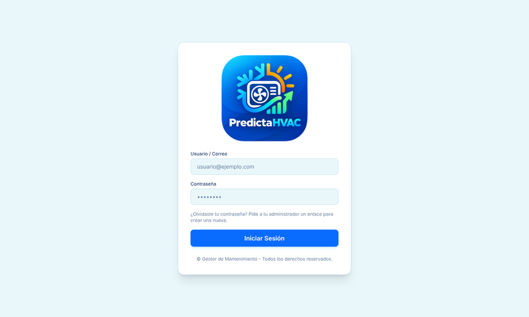
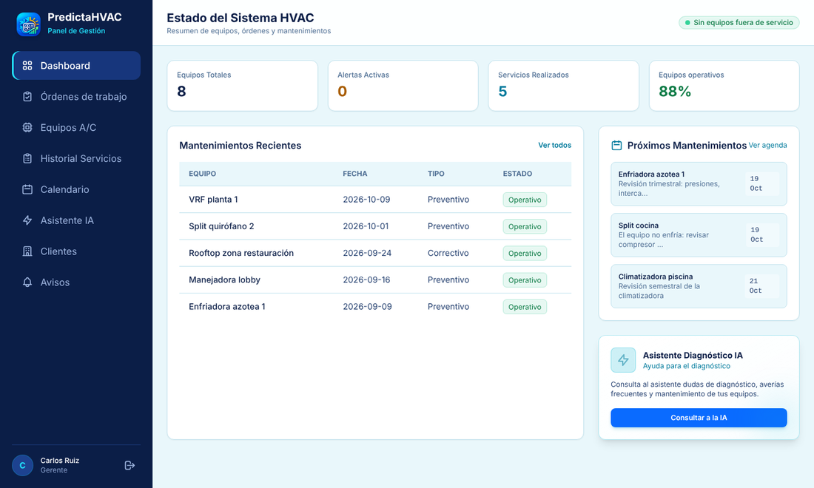
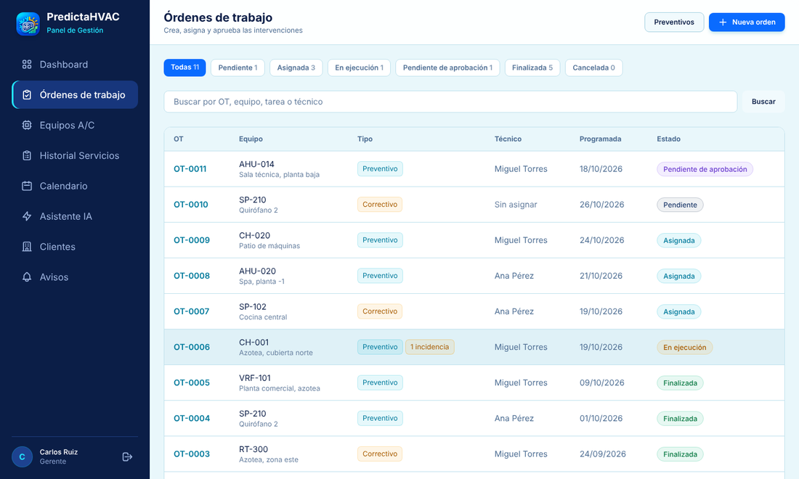
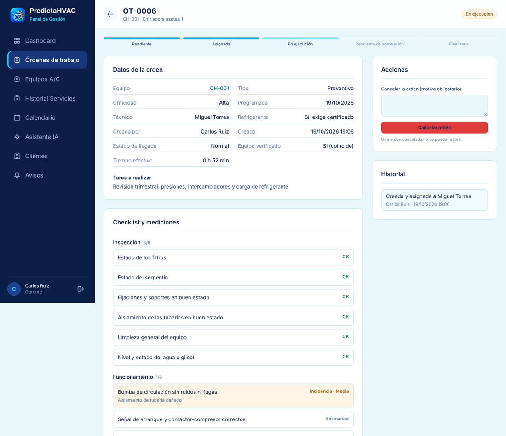
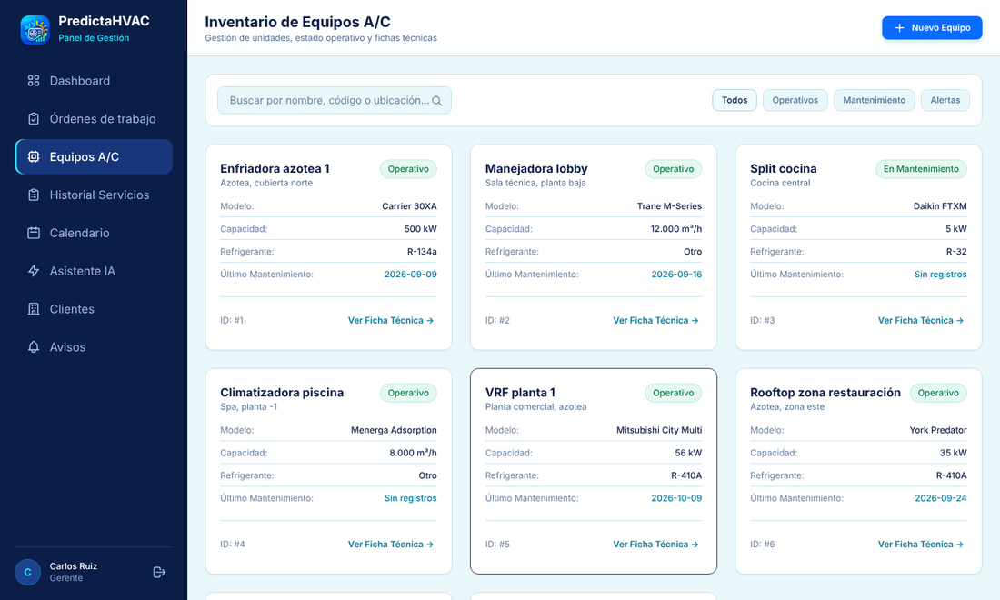
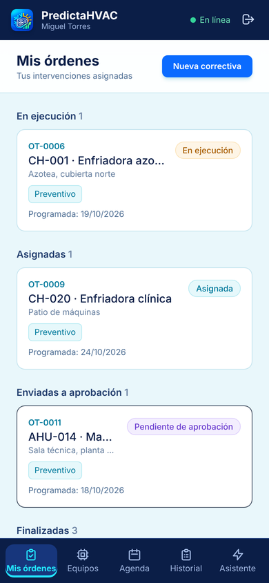
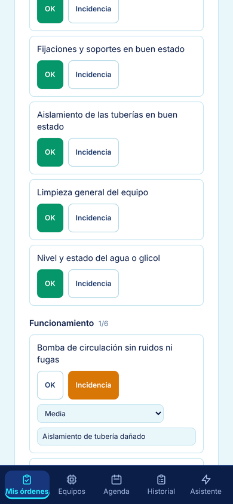

# PredictaHVAC

**Una aplicación para organizar el mantenimiento de equipos de aire acondicionado y climatización (HVAC), desde que se pide un trabajo hasta que el cliente recibe el informe firmado.**

Pensada para empresas de mantenimiento que hoy trabajan con papeles, hojas de cálculo y mensajes sueltos, y quieren tener todo en un solo sitio: qué equipos hay, quién va a revisarlos, qué se hizo y qué falta por hacer.

> Estado: **versión piloto**. El funcionamiento completo está terminado y probado. Qué falta para una versión 1.0 está en [docs/ESTADO_Y_PENDIENTES.md](docs/ESTADO_Y_PENDIENTES.md).
> Todos los nombres, clientes y datos que aparecen en las imágenes son **ficticios**.

---

## ¿Qué problema resuelve?

| Antes | Con PredictaHVAC |
|---|---|
| Los trabajos se piden por teléfono o WhatsApp y se pierden | Cada trabajo es una **orden de trabajo** con responsable, fecha y estado |
| El técnico rellena papeles en la obra y luego los pasa a ordenador | El técnico lo hace **desde el móvil**, incluso **sin cobertura** |
| Nadie sabe cuándo toca la próxima revisión de cada equipo | La aplicación **programa y recuerda** los mantenimientos |
| El informe para el cliente se hace a mano | Se genera un **informe en PDF con fotos y firmas** y se envía por correo |
| Si algo sale mal, no queda constancia | Queda el **historial completo** de cada equipo y de cada orden |

## ¿Cómo funciona? (en 5 pasos)

1. **Se registra al cliente, su instalación y sus equipos.** Cada equipo tiene una ficha y una etiqueta con código QR para pegarla en la máquina.
2. **La gerencia crea una orden de trabajo** (una revisión, una avería, una emergencia) y la asigna a un técnico.
3. **El técnico la ejecuta desde el móvil:** confirma que está ante el equipo correcto, sigue una lista de comprobaciones, anota mediciones, hace fotos y recoge la firma del cliente. Todo funciona sin conexión y se sincroniza cuando vuelve la cobertura.
4. **La gerencia revisa y aprueba** (o devuelve la orden pidiendo correcciones).
5. **El cliente recibe el informe en PDF** por correo y el trabajo queda guardado en el historial del equipo.

## Así se ve

### En el ordenador (gerencia y administración)

**Acceso**



**Panel principal:** resumen del estado de los equipos, últimos servicios y próximos mantenimientos.



**Órdenes de trabajo:** todas las órdenes, filtrables por estado y buscables.



**Detalle de una orden:** lista de comprobaciones, mediciones, fotos, firmas e historial de lo ocurrido.



**Inventario de equipos**



### En el móvil (técnicos de campo)

| Mis órdenes | Lista de comprobaciones |
|:---:|:---:|
|  |  |

### Etiqueta QR para cada equipo

Se imprime en 6 × 6 cm y se pega en la máquina. Sirve para identificarla sin errores.


---

## Qué incluye

**Para la gerencia**
- Clientes, instalaciones y equipos organizados por niveles.
- Creación y asignación de órdenes: preventivas, correctivas y de emergencia.
- Aprobación de trabajos, con opción de pedir correcciones antes de cerrarlos.
- Avisos dentro de la aplicación y por correo cuando pasa algo que requiere atención.
- Calendario de mantenimientos y generación automática de las revisiones periódicas.
- Informe PDF con fotos y firmas, enviado al cliente por correo.
- Asistente con inteligencia artificial para consultas de diagnóstico.

**Para los técnicos**
- Aplicación instalable en el móvil que **funciona sin conexión**.
- Comprobación de que están ante el equipo correcto (código o QR).
- Lista de comprobaciones y mediciones con control de valores fuera de rango.
- Fotos, firma del cliente y firma del técnico.
- Control de la certificación de manipulación de gases fluorados.

**Para el cierre de cada trabajo**
- Al terminar, siempre se decide qué sigue: programar una nueva revisión, abrir una orden correctiva o cerrar sin más acciones.
- Todo queda en el historial del equipo.

## Roles de usuario

| Rol | Qué puede hacer |
|---|---|
| **Administrador** | Todo, incluida la gestión de usuarios y el registro de actividad |
| **Gerente** | Crear y asignar órdenes, aprobar trabajos, gestionar clientes y equipos |
| **Técnico** | Ver y ejecutar sus propias órdenes desde el móvil |

## Seguridad y privacidad

- Acceso con usuario y contraseña, y **verificación en dos pasos** (como las aplicaciones de banca).
- Cada persona solo ve lo que le corresponde por su rol; los técnicos solo ven sus propios trabajos.
- Las firmas de los informes llevan un **sello de integridad** que permite detectar si se han alterado.
- Registro de actividad: quién hizo qué y cuándo.
- Copias de seguridad cifradas y datos del móvil que **caducan** automáticamente.
- Pensada para que **cada cliente use su propia infraestructura**: sus datos no se mezclan con los de nadie más.

## Estado del proyecto

- ✅ Funcionamiento completo de órdenes, clientes, equipos, informes y trabajo sin conexión.
- ✅ Más de 700 pruebas automáticas que comprueban que todo sigue funcionando tras cada cambio.
- 🔜 Próximos pasos: piloto con técnicos reales, escáner QR con la cámara del móvil, instalador de un solo paso y manual de usuario.

Detalle completo en [docs/ESTADO_Y_PENDIENTES.md](docs/ESTADO_Y_PENDIENTES.md).

---

## Licencia

© 2026 Federico Serra. Todos los derechos reservados. El código se muestra para consulta; para usarlo, copiarlo o adaptarlo hace falta autorización por escrito. Ver [LICENSE](LICENSE).

---

<details>
<summary><strong>Para el equipo técnico</strong></summary>

**Tecnologías:** Django (Python), PostgreSQL, Tailwind CSS, JavaScript sin dependencias, aplicación web instalable (PWA) con IndexedDB y Service Worker, informes PDF con ReportLab, asistente con la API de Groq.

**Arrancar en local**
```
python -m venv venv
venv\Scripts\activate          # en Linux/Mac: source venv/bin/activate
pip install -r requirements.txt
copy .env.example .env         # y rellenarlo
python manage.py migrate
python manage.py runserver
```

**Pruebas**
```
python manage.py test
node --test "jstests/*.test.mjs"
```

**Despliegue y operación**
- [DEPLOY.md](DEPLOY.md): puesta en producción, correo y tareas programadas.
- [deploy/restaurar.md](deploy/restaurar.md): restauración de copias de seguridad.
- [docs/POLITICA_USO_DISPOSITIVOS.md](docs/POLITICA_USO_DISPOSITIVOS.md): política de uso de los móviles de los técnicos.

</details>
